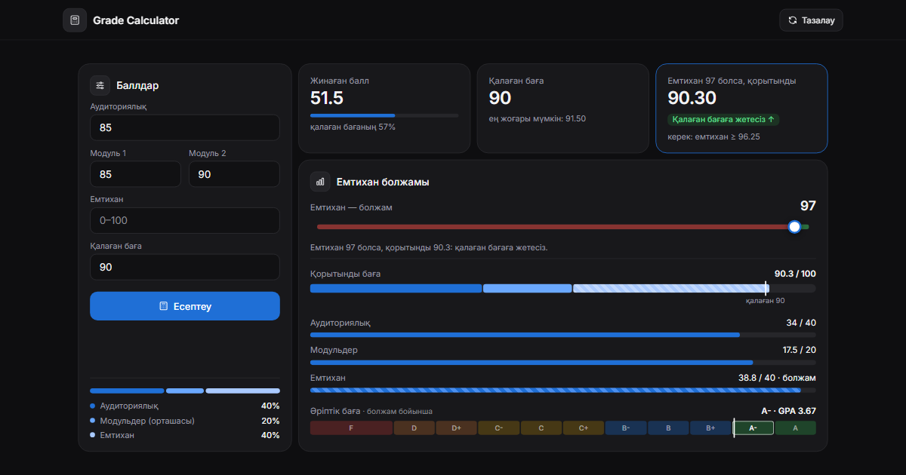

# 📊 Grade Calculator

**Grade Calculator** — веб-приложение для студентов, которое считает итоговую оценку по модульной системе и показывает, сколько баллов нужно набрать, чтобы получить желаемую оценку. Интерфейс на казахском языке.



## 🚀 Возможности

- Ввод баллов: аудиториялық, модуль 1 и 2, емтихан, желаемая оценка. Дроби можно писать и через точку, и через запятую.
- Все баллы введены → итоговая оценка, буква и GPA.
- Не хватает одного балла (экзамена, модуля или среднего по модулям) → минимум, который нужно набрать, и слайдер «а что если»: двигаете значение и видите итог.
- Не введены модули и экзамен → слайдеры для модулей; цветные зоны показывают, где цель недостижима, очень трудна или реальна.
- График «Баллдың құрамы»: вклад каждой части, общая полоса с отметкой цели и шкала буквенных оценок.
- Подсказки с расчётом при наведении, фокусе или нажатии на любую часть графика.
- Значения сохраняются в `localStorage` и восстанавливаются при следующем открытии.
- Две раскладки: дашборд для ноутбука (помещается в экран без прокрутки) и вид приложения для телефона.

## 🧮 Как работает расчёт

```
Итог = Аудиториялық × 0.4 + (Модуль 1 + Модуль 2) / 2 × 0.2 + Емтихан × 0.4
```

Буквенная оценка — по шкале кредитной системы РК: A 95–100, A- 90–94, B+ 85–89, B 80–84, B- 75–79, C+ 70–74, C 65–69, C- 60–64, D+ 55–59, D 50–54, ниже 50 — FX/F. Если в вашем вузе границы другие, поменяйте массив `GRADE_SCALE` в начале `script.js`.

## 🛠️ Технологии

- HTML5, CSS3 (grid, переменные, адаптивная вёрстка), JavaScript без библиотек
- Шрифт Inter (Google Fonts)

## 📂 Структура проекта

```
📦 project-root/
├── index.html  # Разметка страницы
├── style.css   # Стили (ноутбук, планшет, телефон)
├── script.js   # Расчёт, слайдеры, график, подсказки
├── main_logo.png # Логотип: шапка сайта и иконка вкладки (512×512, прозрачный фон)
└── og.png      # Картинка-превью для ссылок (1200×630)
```

## 🧑‍💻 Авторы

- Isatay — разработка логики, интерфейс и дизайн
- INFOGO CLUB — поддержка, продвижение

## 📄 Лицензия

MIT License — свободно используйте и модифицируйте под свои цели.
